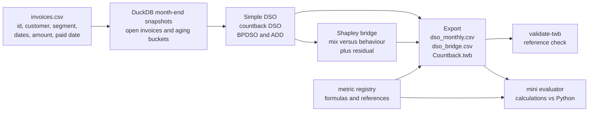

# countback

[](https://github.com/SlateGitOrg/countback/actions/workflows/ci.yml)


Countback measures days sales outstanding (DSO) for a seasonal wholesaler by the age of its open
receivables instead of by a trailing sales average, so a sales ramp stops reading as customers
paying slower. It computes month-end AR snapshots and aging in DuckDB SQL, simple and countback
DSO, best-possible DSO (BPDSO) and average days delinquent (ADD) per customer segment, and a
two-factor Shapley bridge that splits any change in the segment-weighted DSO index into customer
mix and payment behaviour with no unexplained remainder. It then exports the tables and a Tableau
workbook (`.twb`) whose calculated fields are checked by reference validation and by a small
evaluator that must reproduce the Python numbers. All data is synthetic.

## The problem

A building-materials wholesaler sells roofing, siding and lumber to dealers, contractors and
homebuilders. Sales run about 2.5 times higher in summer than in winter. It reports DSO with the
textbook formula, AR divided by trailing sales, which swings by two weeks with the season while
customers' paying behaviour does not change. Credit managers chase phantom deterioration in one
season and miss real slippage in the other, and the CFO cannot tell whether a DSO change came from
who the customers are or from how they pay.

## How it works



An invoice is open at a month-end when it is dated on or before that day and not paid on or before
it. Aging buckets count days past due from the due date: current (not past due), 1-30, 31-60,
61-90 and 90+.

Countback DSO walks back from the snapshot month through monthly sales until the AR balance is
used up, counting the days of every month it consumes and a fraction of the last one. With
January 100,000, February 120,000 and March 150,000 in sales and AR of 210,000 at March 31, it
takes all of March (31 days) and half of February (0.5 x 28 days): 45.0 days. BPDSO applies the
same walk to the current (not past due) part of AR, and ADD is DSO minus BPDSO. If AR is larger
than all the sales history available, the result is the full day count and the row is flagged
rather than capped.

The bridge uses the index I = sum over segments of w x D, where w is the segment's share of
trailing three-month sales and D its countback DSO. Per segment, mix is the change in w times the
average D, and behaviour is the average w times the change in D. They add up to the change in I
exactly. The portfolio countback DSO (countback on total AR over total sales) differs slightly
from I; that gap is printed as the residual.

## Quick start

```bash
python3 -m venv .venv                  # any Python 3.11+ works
.venv/bin/pip install -e ".[dev]"

.venv/bin/countback generate --seed 7 --out data     # invoices.csv and truth.json
.venv/bin/countback aging --month 48                 # AR aging at a month-end
.venv/bin/countback dso --last 12                    # simple, countback, BPDSO, ADD
.venv/bin/countback bridge --from 29 --to 33         # behaviour event
.venv/bin/countback bridge --from 36 --to 48         # mix shift
.venv/bin/countback export-tableau                   # tableau/data/*.csv and Countback.twb
.venv/bin/countback validate-twb                     # check the workbook
```

`generate --no-dispute` writes the counterfactual run used in the tests.

## Example output

The data covers 420 customers in three segments over 48 months (about 25,000 invoices), preceded
by six warm-up months so the first month-end has sales to count back through. Month 1 is
January 2022. Last 12 months of `countback dso`, total company, in days; "true lag" is the sales-weighted
pay lag the generator used:

```text
All: days
 month         end   simple  countback   BPDSO    ADD  true lag
    37  2025-01-31     54.3       56.8    39.9   16.9      54.7
    38  2025-02-28     55.2       54.1    41.8   12.3      55.1
    39  2025-03-31     60.5       54.2    41.9   12.3      55.4
    40  2025-04-30     63.2       52.7    41.5   11.2      55.8
    41  2025-05-31     60.2       53.3    42.1   11.2      55.8
    42  2025-06-30     56.9       55.6    43.7   11.9      56.3
    43  2025-07-31     56.5       56.1    43.3   12.8      56.9
    44  2025-08-31     55.6       56.7    43.9   12.8      57.1
    45  2025-09-30     51.5       56.3    43.9   12.4      57.2
    46  2025-10-31     50.2       59.5    45.1   14.5      57.6
    47  2025-11-30     51.2       58.6    44.7   13.9      57.8
    48  2025-12-31     56.2       59.8    45.5   14.3      58.1
```

Simple DSO reaches 63.2 in April while the true lag is 55.8, then falls to 50.2 by October while
the true lag keeps rising; countback stays within 3.1 days of the true lag in every one of these
months (largest gap in April). Over months 1-12, when behaviour is constant, simple DSO ranges from 41.7 to 59.5 (17.9
days) and countback DSO from 49.3 to 52.3 (3.0 days).

The behaviour event: homebuilders pay 15 days slower from month 30.

```text
Shapley bridge, month 29 -> 33 (days)
segment         w from    w to  DSO from  DSO to     mix  behaviour
dealers          0.249   0.252      63.6    63.2    0.19      -0.11
contractors      0.451   0.446      42.4    41.8   -0.17      -0.27
homebuilders     0.301   0.302      50.2    65.4    0.06       4.56
index I: 50.01 -> 54.27  change +4.26
  mix +0.08  behaviour +4.18  (sum +4.26)
  mix share 2%  behaviour share 98%
portfolio countback DSO: 49.85 -> 54.52; residual (portfolio - I): -0.16 -> +0.24
```

The mix shift: the dealer share of sales rises from 25% to 50% across months 36-48 with constant
behaviour. Months 36 and 48 are the same calendar month, so seasonality cancels.

```text
Shapley bridge, month 36 -> 48 (days)
segment         w from    w to  DSO from  DSO to     mix  behaviour
dealers          0.252   0.473      68.2    68.1   15.11      -0.04
contractors      0.447   0.319      39.8    40.4   -5.13       0.23
homebuilders     0.302   0.208      64.3    68.1   -6.20       0.96
index I: 54.37 -> 59.28  change +4.91
  mix +3.77  behaviour +1.14  (sum +4.91)
  mix share 77%  behaviour share 23%
portfolio countback DSO: 54.78 -> 59.76; residual (portfolio - I): +0.41 -> +0.48
```

The weights are shares of trailing three-month sales, so the month 48 dealer weight (0.473) is
below the 50% share of that month alone. The behaviour term here, 1.14 days, is sampling noise in
segment DSOs that the generator did not inject.

The workbook check:

```text
OK: 2 datasources, 4 calculated fields, 4 worksheets, 1 dashboard; evaluated 4 calculations on 192 rows (max abs diff vs reference 0.00e+00)
```

## Design decisions

**Countback instead of a smoothed simple DSO.** Averaging sales over more months reduces the
swing in the simple formula but never removes it, because the mismatch is structural: AR holds
the last two months of sales and the denominator holds three. Countback matches AR against the
sales it came from. The cost is that it assumes sales are even within a month and works at monthly
granularity. In steep seasonal ramps it reads a few days short of the true mean lag; the largest
gap against the generator's lag in months 1-29 is 2.4 days, and the test allows 4.

**Two-factor Shapley for the bridge.** A one-factor-at-a-time split (mix first, then behaviour)
puts the interaction term in whichever factor goes second, so the answer depends on the order.
Averaging the two orders per segment gives the Shapley values, which are order-free and sum to the
change in I exactly. The price is that mix and behaviour are defined for the index, not for the
portfolio countback figure; the residual between the two is printed instead of being allocated.

**DuckDB for snapshots, Python for the walk.** The month-end AR, the aging buckets and sales are a
range join plus grouping sets, which SQL states directly and runs in a fraction of a second on
25,000 invoices. The countback walk is sequential per month and segment, so it is a short Python
function, which also makes the hand fixture a plain unit test.

**Warm-up history instead of special-casing the early months.** At the first month-end there are
no earlier sales to count back through. The generator emits six months of invoices before month 1
and the loader treats them as history, so reported month 1 is a real snapshot. When AR does exceed
the sales on record the row is flagged in `dso_flagged` and the day count is the full history; no
reported month in the seeded data is flagged.

**Calculated fields limited to an arithmetic subset.** Tableau calculations are restricted to
field references, numbers, `SUM`, `ZN`, `+ - * /` and parentheses, so a small evaluator can run
them on every exported row and compare with the Python reference in `countback/metrics.py`. That
catches a wrong formula, not only a wrong field name. It cannot check level-of-detail or table
calculations, and the workbook is validated as XML and arithmetic only: it has not been opened in
Tableau here.

**Segment sales pinned to targets.** The generator scales each segment's monthly invoices to a
target (shared seasonality times the segment share, with 2% noise), so the shares move only where
the mix shift is injected. Real shares are noisier. The truth file records the generator's lag
parameters per segment and month, not the realised average, so the test compares countback with
what the customers were told to do rather than with one random draw.

## Testing

```bash
.venv/bin/python -m pytest -q
```

The suite is offline and uses the seeded data plus hand-built ledgers. It covers the 45.0-day hand
fixture and the history-exhausted flag, aging bucket boundaries (an invoice due on the snapshot day
is current, one paid on it is closed), buckets = open invoices = AR at every month-end recomputed in
pandas, BPDSO <= DSO and ADD >= 0, countback within 4 days of the true lag in months 1-29 while
simple DSO swings at least 12 days in each of the first two years, the homebuilder rise of at least
10 days between months 29 and 33, the bridge shares (at least 80% behaviour for 29 to 33, at least
60% mix for 36 to 48, mix + behaviour = change), the no-dispute counterfactual (contractor ADD
lower in months 42-44, every month before 41 unchanged), workbook validation on the shipped file,
mutated copies that must fail (a `[AR Totl]` reference, an unregistered field name, a bad
worksheet column, a formula that disagrees with its reference), and the mini evaluator against the
pipeline's own numbers.

CI runs `ruff check .`, `ruff format --check .` and `pytest -q` on Python 3.12 and 3.13.

## Project layout

```text
src/countback/
  generator.py      seeded invoices and truth.json, injected events
  aging.py          DuckDB loader, month-end snapshots, aging buckets, sales
  dso.py            countback walk, simple DSO, BPDSO, ADD table
  bridge.py         Shapley bridge and residual
  metrics.py        registry of calculated fields: formula and Python reference
  tableau.py        CSV export and .twb builder
  twb_eval.py       mini evaluator for the calculation subset
  twb_validate.py   reference checks and evaluation against the registry
  cli.py            typer commands
tableau/
  Countback.twb     workbook: two textscan datasources, 4 worksheets, 1 dashboard
  data/             dso_monthly.csv, dso_bridge.csv
tests/              85 tests
```

## License

MIT. See `LICENSE`.
